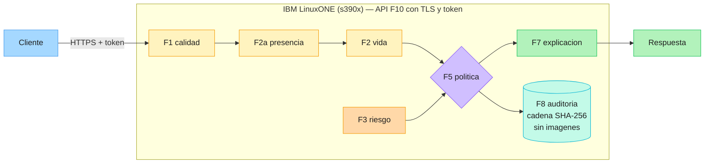

# TrustGate Z
**English** · [Español](README.es.md)

IBM Z Datathon 2026 — an identity-fraud decision layer running on LinuxONE (s390x).

TrustGate Z answers five questions about an account-opening or credit
application and returns a traceable decision: is there a face?, is it a live
person?, is the capture good enough?, is the fraud risk high?, and which action
applies. Every decision is recorded in a hash chain that stores no images.

## Architecture



Node labels in the diagram are in Spanish, matching the module names used in
the code.

### How to read it

1. The **client** sends the application to the **F10** service over HTTPS with
   a Bearer token. Everything inside the box runs on **IBM LinuxONE (s390x)**.
2. Evidence is evaluated in a fixed order: **F1 quality** → **F2a presence** →
   **F2 liveness**. The first step that fails decides the action.
3. **F3 risk** feeds **F5** as a fourth signal, computed on the application
   data (not on the image).
4. **F5 policy** returns one of four actions: APROBAR (approve), RECAPTURAR
   (recapture), VERIFICAR (verify) or RETENER (hold), always with a reason.
5. **F7 explanation** turns that action into text for the applicant, and that
   is the **response** leaving the system.
6. **F8 audit** records every decision in a SHA-256 hash chain. It stores the
   action, reason, risk and session id; **never images or personal data**.

## Media

- **Video presentation:** [TrustGate Z on YouTube](https://youtu.be/PiZ3nOL1RUc) — 3-minute demo showing the system in action.
- **Slides:** [TrustGate Z on Canva](https://canva.link/8ruj0crswd8x5cf) — presentation deck (10 slides).

## Modules

| Module | What it does | Code | Tests |
|---|---|---|---|
| **F1** quality | Size, sharpness and brightness of the capture | [`f1_calidad/`](f1_calidad/) · [README](f1_calidad/README.md) | 11 |
| **F2a** presence | Is there a face in the image? | [`f2a_presencia/`](f2a_presencia/) · [README](f2a_presencia/README.md) | — |
| **F2** liveness | A live person or a presentation attack? | [`f2_vida/`](f2_vida/) · [README](f2_vida/README.md) | — |
| **F3** risk | Fraud risk of the application | [`f3_riesgo/`](f3_riesgo/) · [README](f3_riesgo/README.md) | — |
| **F5** policy | Combines the evidence into one action: APROBAR, RECAPTURAR, VERIFICAR, RETENER | [`f5_politica/`](f5_politica/) · [README](f5_politica/README.md) | 49 |
| **F6** simulator | Runs batches of scenarios through the F5 policy | [`f6_simulador/`](f6_simulador/) | 14 |
| **F7** explanation | Plain-language text for the applicant, from the decision | [`f7_explicacion/`](f7_explicacion/) | 36 |
| **F8** audit | SHA-256 hash-chained log, with no images | [`f8_auditoria/`](f8_auditoria/) | 20 |
| **F9** fairness | False-positive rate by age group | [`f9_equidad/`](f9_equidad/) · [README](f9_equidad/README.md) | 11 |
| **F10** API | HTTP service with token and TLS | [`f10_api/`](f10_api/) · [README](f10_api/README.md) | 21 |

F2a, F2 and F3 are evaluated with runs over real data on the LinuxONE virtual
machine; their results live in their READMEs and in [`docs/`](docs/), not in
unit tests. The other modules are tested with synthetic data generated inside
each test.

**F4 (operations) is out of scope for the MVP**, as the team plan states.

Flow: F1 → F2a → F2 → F3 feed **F5**, which decides. F7 explains the decision,
F8 records it and F10 exposes it over HTTP. F6 and F9 are analysis tools over
F5 and F3.

## How to run the tests

162 tests, all with synthetic data. They need neither the virtual machine nor
any data file:

```
pip install -r requirements.txt
python -m pytest tests -q
```

## How to start the API

The service reads the token from `TRUSTGATE_TOKEN`. **Without that variable it
does not start.** The audit log goes to `TRUSTGATE_AUDIT_PATH` (default
`./auditoria.jsonl`, ignored by Git).

For local testing, without TLS:

```
export TRUSTGATE_TOKEN='<token>'
python -m uvicorn f10_api.app:crear_app --factory --host 127.0.0.1 --port 8000
```

With TLS, as it must run in any network-reachable environment:

```
export TRUSTGATE_TOKEN='<token>'
python -m uvicorn f10_api.app:crear_app --factory \
    --host 0.0.0.0 --port 8443 \
    --ssl-keyfile  /ruta/clave.pem \
    --ssl-certfile /ruta/certificado.pem
```

The token travels in an `Authorization: Bearer` header, so **without TLS it
goes in the clear over the network**. Neither certificates nor tokens are in
the repository, and they are not generated from the code: whoever deploys
provides them. Endpoints and status codes in
[`f10_api/README.md`](f10_api/README.md).

## F3 results (application risk)

Model frozen for the MVP, trained on Bank Account Fraud (BAF) Base. Each figure
states the file and line it comes from.

| Measure | Value | Source |
|---|---|---|
| AUC, delivered model (seed 42) | **0.8158** | [`f3_riesgo/README.md:42`](f3_riesgo/README.md) · [`docs/f3_extra.md:60`](docs/f3_extra.md) |
| AUC, mean ± deviation over 5 seeds (42 to 46) | **0.830 ± 0.012** | [`f3_riesgo/README.md:42`](f3_riesgo/README.md) (exact value 0.8298 ± 0.0120 in [`docs/f3_extra.md:60`](docs/f3_extra.md)) |
| False-positive-rate ratio by age (equal false-positive rate), 5 seeds | **0.456 ± 0.018** | [`docs/f3_analisis_equidad.md:142`](docs/f3_analisis_equidad.md), row `base (sin la edad)` (exact value 0.4561 ± 0.0183) |

Seed 42 landed at the low end of the AUC range: the reference figure is the
mean over the 5 seeds, not the one from the delivered seed.

### The false-positive-rate ratio by age is a large gap

0.456 means that, with the same threshold for everyone, honest applicants aged
50 or over receive false alarms at **more than twice** the rate of those under
50: 9.67 % against 4.41 %
([`docs/f3_analisis_equidad.md:142`](docs/f3_analisis_equidad.md)). **It is
reported as it is, without softening.** Part of the gap is explained by the
composition of `housing_status` across groups and part persists within the
categories ([`docs/f3_extra.md:29-30`](docs/f3_extra.md)); explaining part of
the gap does not remove it.

Age is not a model feature (`USE_AGE_AS_FEATURE = False`,
`f3_riesgo/f3_riesgo.py:35`) and no age-specific threshold or check was
implemented. Full analysis in [`f9_equidad/README.md`](f9_equidad/README.md)
and [`docs/f3_analisis_equidad.md`](docs/f3_analisis_equidad.md).

## Declared limitations

- **F1: the thresholds are not calibrated against real data.** `LADO_MINIMO`,
  `UMBRAL_NITIDEZ`, `BRILLO_MIN` and `BRILLO_MAX` are starting values. How many
  legitimate captures they reject, or how many bad ones they accept, was not
  measured on any dataset. A `calidad_ok` of `False` means the image does not
  meet these rules, not that it is unusable; a `True` does not guarantee a good
  capture. See [`f1_calidad/README.md`](f1_calidad/README.md).
- **F2a is provisional**: it tells faces from textures, not face presence
  against any image. In testing, 8.67 % of textures are accepted as a face,
  above the 5 % target. See
  [`f2a_presencia/README.md`](f2a_presencia/README.md).
- **F2 is provisional and must not be used to approve on its own**: a control
  using only file width, height and size scores AUC 0.987, which points to a
  capture shortcut. See [`f2_vida/README.md`](f2_vida/README.md).
- **APROBAR does not amount to a liveness verification** while F2 remains
  provisional. See [`f5_politica/README.md`](f5_politica/README.md).
- **TrustGate Z does not detect AI-generated or deepfake faces; this is future
  work.**
- F3 uses a single temporal split and a single dataset, which is also
  synthetic. See [`f3_riesgo/README.md`](f3_riesgo/README.md).

## Data and licences

No data, model weights or images are in the repository. The licence and
attribution of each dataset are documented in the module that uses it:

- [`f3_riesgo/README.md`](f3_riesgo/README.md) — Bank Account Fraud (BAF)
  Dataset Suite, Feedzai: CC BY-NC-SA 4.0, non-commercial use.
- [`f2a_presencia/README.md`](f2a_presencia/README.md) — non-commercial faces
  (CelebA-Spoof, FFHQ); ambientCG textures, CC0 1.0.
- [`f2_vida/README.md`](f2_vida/README.md) — CelebA-Spoof (Zhang et al., ECCV
  2020), non-commercial use.

The exact CelebA-Spoof terms are still pending confirmation against the dataset
card, as [`f2_vida/README.md`](f2_vida/README.md) states. There is no
consolidated licence manifest in a single file yet.

## Environment

Runs on IBM LinuxONE (s390x, RHEL 9, rootless Podman, image `l1cc-v1`). The
versions in `requirements.txt` are aligned with that image: any new package
goes in through a Pull Request, not a direct install.
