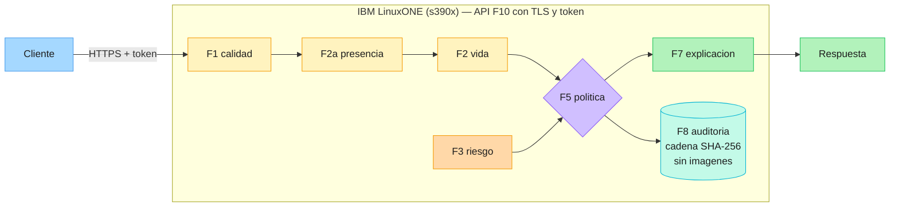

# TrustGate Z

IBM Z Datathon 2026 — capa de decisión contra fraude de identidad sobre LinuxONE (s390x).

TrustGate Z responde cinco preguntas sobre una solicitud de apertura de cuenta
o de crédito y entrega una decisión trazable: ¿hay un rostro?, ¿es una persona
viva?, ¿la captura tiene calidad suficiente?, ¿el riesgo de fraude es alto?, y
¿qué acción corresponde. Cada decisión queda registrada en una cadena de
hashes que no guarda imágenes.

## Arquitectura



### Cómo leerla

1. El **cliente** envía la solicitud al servicio **F10** por HTTPS con un token
   Bearer. Todo lo que está dentro del recuadro corre en **IBM LinuxONE
   (s390x)**.
2. La evidencia se evalúa en orden fijo: **F1 calidad** → **F2a presencia** →
   **F2 vida**. El primer paso que falla decide la acción.
3. **F3 riesgo** entra a **F5** como una cuarta señal, calculada sobre los datos
   de la solicitud (no sobre la imagen).
4. **F5 política** devuelve una de cuatro acciones: APROBAR, RECAPTURAR,
   VERIFICAR o RETENER, siempre con un motivo.
5. **F7 explicación** convierte esa acción en texto para la persona, y esa es
   la **respuesta** que sale del sistema.
6. **F8 auditoría** registra cada decisión en una cadena de hashes SHA-256.
   Guarda acción, motivo, riesgo e identificador de sesión; **nunca imágenes ni
   datos personales**.

## Módulos

| Módulo | Qué hace | Código | Pruebas |
|---|---|---|---|
| **F1** calidad | Tamaño, nitidez y brillo de la captura | [`f1_calidad/`](f1_calidad/) · [README](f1_calidad/README.md) | 11 |
| **F2a** presencia | ¿Hay un rostro en la imagen? | [`f2a_presencia/`](f2a_presencia/) · [README](f2a_presencia/README.md) | — |
| **F2** vida | ¿Es una persona viva o un ataque de presentación? | [`f2_vida/`](f2_vida/) · [README](f2_vida/README.md) | — |
| **F3** riesgo | Riesgo de fraude de la solicitud | [`f3_riesgo/`](f3_riesgo/) · [README](f3_riesgo/README.md) | — |
| **F5** política | Combina la evidencia en una acción: APROBAR, RECAPTURAR, VERIFICAR, RETENER | [`f5_politica/`](f5_politica/) · [README](f5_politica/README.md) | 49 |
| **F6** simulador | Pasa lotes de escenarios por la política de F5 | [`f6_simulador/`](f6_simulador/) | 14 |
| **F7** explicación | Texto para el usuario final a partir de la decisión | [`f7_explicacion/`](f7_explicacion/) | 36 |
| **F8** auditoría | Bitácora encadenada con SHA-256, sin imágenes | [`f8_auditoria/`](f8_auditoria/) | 20 |
| **F9** equidad | Tasa de falsos positivos por grupo de edad | [`f9_equidad/`](f9_equidad/) · [README](f9_equidad/README.md) | 11 |
| **F10** API | Servicio HTTP con token y TLS | [`f10_api/`](f10_api/) · [README](f10_api/README.md) | 21 |

F2a, F2 y F3 se evalúan con corridas sobre datos reales en la máquina virtual
de LinuxONE; sus resultados están en sus README y en [`docs/`](docs/), no en
pruebas unitarias. Los demás módulos se prueban con datos sintéticos generados
dentro de cada prueba.

**F4 (operación) queda fuera del MVP**, como indica el plan del equipo.

Flujo: F1 → F2a → F2 → F3 alimentan a **F5**, que decide. F7 explica la
decisión, F8 la registra y F10 lo expone por HTTP. F6 y F9 son herramientas de
análisis sobre F5 y F3.

## Cómo correr las pruebas

162 pruebas, todas con datos sintéticos. No necesitan la máquina virtual ni
ningún archivo de datos:

```
pip install -r requirements.txt
python -m pytest tests -q
```

## Cómo levantar la API

El servicio lee el token de `TRUSTGATE_TOKEN`. **Sin esa variable no
arranca.** La bitácora de auditoría va a `TRUSTGATE_AUDIT_PATH` (por defecto
`./auditoria.jsonl`, ignorada por Git).

Para pruebas locales, sin TLS:

```
export TRUSTGATE_TOKEN='<token>'
python -m uvicorn f10_api.app:crear_app --factory --host 127.0.0.1 --port 8000
```

Con TLS, como debe correr en cualquier entorno accesible por red:

```
export TRUSTGATE_TOKEN='<token>'
python -m uvicorn f10_api.app:crear_app --factory \
    --host 0.0.0.0 --port 8443 \
    --ssl-keyfile  /ruta/clave.pem \
    --ssl-certfile /ruta/certificado.pem
```

El token viaja en un encabezado `Authorization: Bearer`, así que **sin TLS va
en claro en la red**. Ni los certificados ni los tokens están en el
repositorio, y no se generan desde el código: los provee quien despliega.
Detalle de endpoints y códigos de estado en [`f10_api/README.md`](f10_api/README.md).

## Resultados de F3 (riesgo de la solicitud)

Modelo congelado para el MVP, entrenado con Bank Account Fraud (BAF) Base.
Cada cifra indica el archivo y la línea de donde sale.

| Medida | Valor | Fuente |
|---|---|---|
| AUC, modelo entregado (semilla 42) | **0,8158** | [`f3_riesgo/README.md:42`](f3_riesgo/README.md) · [`docs/f3_extra.md:60`](docs/f3_extra.md) |
| AUC, media ± desviación de 5 semillas (42 a 46) | **0,830 ± 0,012** | [`f3_riesgo/README.md:42`](f3_riesgo/README.md) (valor exacto 0,8298 ± 0,0120 en [`docs/f3_extra.md:60`](docs/f3_extra.md)) |
| Razón de FPR por edad (igualdad de tasa de falsos positivos), 5 semillas | **0,456 ± 0,018** | [`docs/f3_analisis_equidad.md:142`](docs/f3_analisis_equidad.md), fila `base (sin la edad)` (valor exacto 0,4561 ± 0,0183) |

La semilla 42 quedó en la parte baja del rango de AUC: la cifra de referencia
es la media de las 5 semillas, no la de la semilla entregada.

### La razón de FPR por edad es una brecha grande

0,456 significa que, con el mismo umbral para todos, las personas honestas de
50 años o más reciben falsas alarmas a **más del doble** de la tasa de las
menores de 50: 9,67 % frente a 4,41 %
([`docs/f3_analisis_equidad.md:142`](docs/f3_analisis_equidad.md)). **Se
reporta así, sin suavizar.** Parte de la brecha se explica por la composición
de `housing_status` entre grupos y parte persiste dentro de las categorías
([`docs/f3_extra.md:29-30`](docs/f3_extra.md)); explicar parte de la brecha no
la elimina.

La edad no es variable del modelo (`USE_AGE_AS_FEATURE = False`,
`f3_riesgo/f3_riesgo.py:35`) y no se implementó ningún umbral ni verificación
distinta por edad. Análisis completo en
[`f9_equidad/README.md`](f9_equidad/README.md) y
[`docs/f3_analisis_equidad.md`](docs/f3_analisis_equidad.md).

## Límites declarados

- **F1: los umbrales no están calibrados con datos reales.** `LADO_MINIMO`,
  `UMBRAL_NITIDEZ`, `BRILLO_MIN` y `BRILLO_MAX` son valores de partida. No se
  midió cuántas capturas legítimas rechazan ni cuántas malas aceptan, en
  ningún conjunto de datos. Un `calidad_ok` en `False` indica que la imagen no
  cumple estas reglas, no que sea inservible; un `True` no garantiza una buena
  captura. Ver [`f1_calidad/README.md`](f1_calidad/README.md).
- **F2a es provisional**: distingue rostros de texturas, no presencia de
  rostro frente a cualquier imagen. En prueba, 8,67 % de las texturas se
  aceptan como rostro, por encima del objetivo de 5 %. Ver
  [`f2a_presencia/README.md`](f2a_presencia/README.md).
- **F2 es provisional y no debe usarse para aprobar por sí solo**: un control
  que solo mira ancho, alto y peso del archivo da AUC 0,987, lo que indica un
  atajo de captura. Ver [`f2_vida/README.md`](f2_vida/README.md).
- **APROBAR no equivale a una verificación de vida** mientras F2 siga siendo
  provisional. Ver [`f5_politica/README.md`](f5_politica/README.md).
- F3 usa una sola partición temporal y un solo conjunto de datos, que además
  es sintético. Ver [`f3_riesgo/README.md`](f3_riesgo/README.md).

## Datos y licencias

Ningún dato, peso de modelo ni imagen está en el repositorio. Las licencias y
atribuciones de cada conjunto se documentan en el módulo que lo usa:

- [`f3_riesgo/README.md`](f3_riesgo/README.md) — Bank Account Fraud (BAF)
  Dataset Suite, Feedzai: CC BY-NC-SA 4.0, uso no comercial.
- [`f2a_presencia/README.md`](f2a_presencia/README.md) — rostros de uso no
  comercial (CelebA-Spoof, FFHQ); texturas de ambientCG, CC0 1.0.
- [`f2_vida/README.md`](f2_vida/README.md) — CelebA-Spoof (Zhang et al., ECCV
  2020), uso no comercial.

Los términos exactos de CelebA-Spoof siguen pendientes de confirmar contra la
ficha del conjunto, como indica
[`f2_vida/README.md`](f2_vida/README.md). No hay todavía un manifiesto de
licencias consolidado en un solo archivo.

## Entorno

Corre en IBM LinuxONE (s390x, RHEL 9, Podman rootless, imagen `l1cc-v1`). Las
versiones de `requirements.txt` están alineadas con esa imagen: cualquier
paquete nuevo entra por Pull Request, no por instalación directa.
